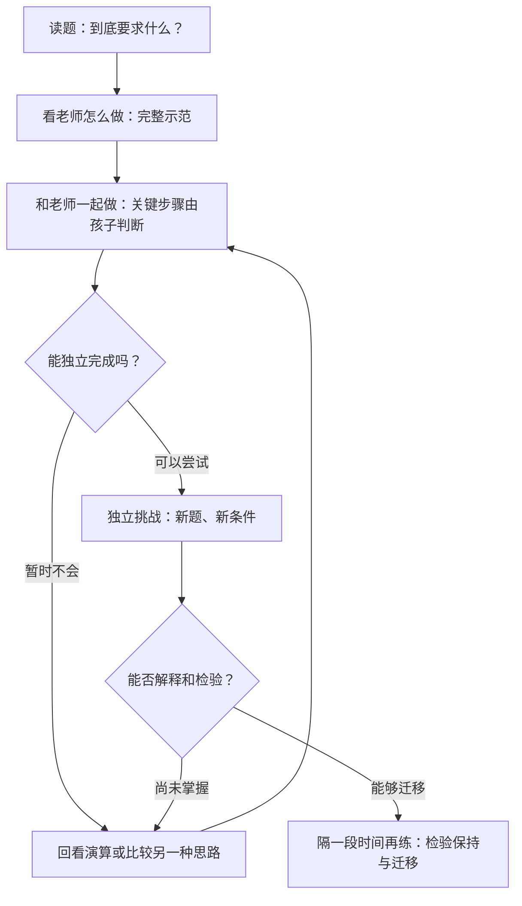

# 林老师数学教室 · 看得见的数学思维

**作者：张凌博士**

**版权 © 2026 张凌博士｜免费使用 · 禁止商业用途** · [完整版权声明](LICENSE.md)

> **像练球一样练数学：观察高手，理解动作，亲手尝试，发现错误，调整策略，最终能够独立解决陌生问题。**

[**进入新版数学教室 →**](https://zhanglingshare.github.io/grade7-math-visualized/math-home/)

## 为什么做这个项目？

孩子可能记住了公式，却不知道公式从哪里来；能够模仿例题，却在条件稍有变化时无从下手；在家长讲解时频频点头，却不能独立完成一道新题。

这些现象提醒我们：**听懂、会做与真正理解，是三个不同的层次。**

本项目是一套面向初中生的交互式数学思维训练环境，以人教版七年级上册教材为主要依据，将数学概念、运算规则与实际问题转化为可观察的数学模型、动态演示和分步练习。它不是把教材搬到屏幕上，也不是试图用动画和积分包装题库，而是尝试让孩子经历知识的形成过程。

我们借鉴运动训练的逻辑：高手不会只告诉初学者最后得了几分，而会展示如何观察、判断、选择动作、纠正失误，并通过不同情境反复练习。数学学习也应如此。

## 一、训练什么能力？

| 能力 | 具体训练方式 |
| --- | --- |
| 数感与空间思维 | 用数轴、方向、距离、对称、数量变化理解数学符号 |
| 结构识别 | 发现不同题目背后的共同关系，而不是记忆题型名称 |
| 抽象与建模 | 将现实情境转换为数量关系、代数式和方程 |
| 逻辑推理 | 追问规则为什么成立、成立的条件是什么，并尝试用反例检验 |
| 运算与等价变换 | 理解每一次变形的依据，识别符号、括号、运算顺序等错误 |
| 策略选择与迁移 | 比较不同方法，在题目条件发生变化后仍能独立求解 |
| 自主学习与复盘 | 发现自己卡在哪里，选择回看、重练或寻找另一条思路 |

这些是训练目标，不是已经通过教育测量证实的学习效果。

## 二、孩子如何学习？

### 1. 看老师怎么做——建立完整的解题样本

林老师通过中文语音、数学动画和分步演算，帮助孩子看清问题、条件、关系与求解过程。孩子可以先观察和理解，不必一进入课堂就被要求回答问题。

### 2. 和老师一起做——逐渐撤掉帮助

将复杂问题拆成关键步骤，让孩子点击、输入、计算或使用草稿板。老师负责讲解和反馈，孩子负责判断与思考。遇到困难时，可以回看演算，而不是一直猜答案。

### 3. 看高手的另一种思路——比较，而不是背更多套路

例如同一道有理数加法题，可以借助数轴理解方向，也可以借助正负筹码理解抵消。同一道方程题，可以比较算术方法与等量关系方法。

只有当另一种方法能够揭示新的数学结构、提供更简洁的推理或帮助检查错误时，才值得引入。并不强求每一道题都存在多种有意义的解法。

### 4. 独立挑战——判断学习是否真的发生

换数字、换条件、换情境，让孩子自己完成计算和判断。正确答案只是证据之一；更重要的是孩子能否解释关键步骤、发现不合理的结果，并在以后面对新题时再次使用所学方法。

### 5. 错误与复盘——让失误成为下一次训练的线索

训练时区分读题错误、概念错误、符号错误、运算错误和策略错误。针对真正卡住的环节回到相应课堂，而不是无差别增加练习量。现有自动反馈能力主要基于答案判定及预设解释，复杂错因仍需孩子自查或家长、教师协助判断。

## 三、为什么使用动画、互动和虚拟老师？

数学动画的价值不在于画面会动，而在于让不可见的关系变得可见。

- **数轴**：将正负数转化为方向与距离，将加减法转化为位置变化。
- **正负筹码**：观察同号合并、异号抵消，理解运算法则。
- **天平与等式**：观察两边实施同一种运算后仍然保持相等，理解方程变形。
- **生产、追及、工程与费用模型**：观察变量变化如何影响结果，理解现实情境中的等量关系。
- **进位制实验**：操作数字位权和二进制开关，体验数字系统的形成逻辑。

虚拟老师承担引导、解释、提问和反馈的角色；人物、语音和动画服务于注意力与数学理解，而不是与题目争夺注意力。孩子可以通过触控或输入参与，不要求一直对设备说话。

## 四、目前的新版课程

**主学习入口：[林老师数学教室](https://zhanglingshare.github.io/grade7-math-visualized/math-home/)**

| 课程 | 训练重点 | 访问 |
| --- | --- | --- |
| 第一章 · 有理数 | 方向、位置、距离、数的分类与比较 | [27个主题 · 81道挑战](https://zhanglingshare.github.io/grade7-math-visualized/ct1128-chapter1/) |
| 第二章 · 有理数的运算 | 运算规则的形成、符号、简算与运算顺序 | [47个主题 · 141道挑战](https://zhanglingshare.github.io/grade7-math-visualized/ct1128-chapter2/) |
| 第三章 · 代数式 | 从具体数量到抽象表达、识别结构 | [40个主题 · 200道练习](https://zhanglingshare.github.io/grade7-math-visualized/ct1128-chapter3/) |
| 第四章 · 整式的加减 | 同类项、去括号与代数结构变换 | [34个主题 · 170道练习](https://zhanglingshare.github.io/grade7-math-visualized/ct1128-chapter4/) |
| 第五章 · 一元一次方程 | 等量关系、等价变形、建模与验算 | [24个主题 · 72道挑战](https://zhanglingshare.github.io/grade7-math-visualized/ct1128-chapter5/) |
| 综合实践 · 进位制 | 数字位权、进制转换、二进制加法 | [8个主题 · 24道挑战](https://zhanglingshare.github.io/grade7-math-visualized/ct1128-number-bases/) |
| 期中错题训练 | 从考试失误回溯概念与解题策略 | [进入训练](https://zhanglingshare.github.io/grade7-math-visualized/ct1127/) |

上述数量是新版课程的内容规模，并非评价孩子水平的指标，也不代表全部教材习题已逐题收录。项目保留旧课程、小学桥梁、单元测试与历史实验，但不将旧版第五章作为新门户的课程入口。

## 五、家长怎样陪练？

建议以每次约20—30分钟的一轮训练为单位，根据孩子的状态灵活调整：先选择一个真正没有掌握的主题，观察一次老师示范，完成若干关键步骤，再独立做一道变式题。最后记录一个发现或一个仍不理解的问题，隔天用新题复查。

不必要求孩子每次都看完整课程。已经掌握的内容可以直接挑战；如果挑战暴露概念缺口，再回到老师的演示。难度应随独立解题表现调整，而不是以完成全部页面为目标。

家长更值得问的是：“你刚才发现了什么？”“哪一步最难？”“如果条件变了，你还会用这个方法吗？” 而不是重复讲解、催促作答或只追问分数。

## 六、如何判断训练有效？

建议观察四类证据，而不是把页面停留时间、动画观看量或刷题数量当成学习成果：

- **理解**：能否用自己的方式解释数学关系。
- **独立**：在没有老师提示时，能否完成一道同结构的新题。
- **迁移**：改变数字、条件或表述后，能否选择合适的方法。
- **保持**：隔天或隔周，能否再次独立解决同类问题。

最终仍应结合纸笔作业、课堂表现和真实考试检验效果。项目不是学校教学的替代品，也不承诺特定分数提升。

## 七、技术、隐私与项目边界

新版课程以 HTML、CSS、JavaScript 和 SVG 实现，使用浏览器中文语音合成及本地学习记录。部分课堂采用共享运行框架，课程内容按章维护。人物表现主要为立绘和视觉动画，而非全部采用真正的三维模型。

语音质量取决于浏览器与设备可用的中文语音；本地进度不会自动跨设备同步。当前部分课堂已通过程序级流程检查，但仍需要真实设备上的视觉、语音、交互验收，以及题目和教学解释的人工复核。尚无独立对照实验能够证明项目的教学效果。

历史版本、资料来源、旧版许可与署名保留于 [历史项目说明](README-history-20261128.md)。历史页面若含第三方素材或数据，仍按各自的许可与署名使用，不能将整个仓库中的第三方内容一概视为原创。

## 八、版权声明

本项目原创内容免费向公众开放，供个人、家庭、学校等进行非商业学习、教学与研究。非商业复制与分享须保留作者署名、版权声明及原项目链接。未经版权所有者事先书面授权，不得用于任何商业目的，包括收费培训、付费课程、商业软件集成、转售及其他营利性用途。

**免费不等于放弃版权，也不等于允许商用。** 第三方内容及历史版本的既有许可继续有效。详细条款见 [版权与非商业使用声明](LICENSE.md)。

---

**我们期待孩子最终获得的不是依赖老师的解题能力，而是逐渐不再依赖老师的思考能力。**
