# 林老师数学教室 · 看得见的数学思维

**作者：张凌博士｜独立研发的教育科技实践**

> **如果孩子能像练球一样主动练数学，会发生什么？**  
> 让孩子从“听懂老师讲题”，走向“独立解决从未见过的问题”。

[**立即体验新版数学教室 →**](https://zhanglingshare.github.io/grade7-math-visualized/math-home/)　·　[课程预览](#课程可视化一览)　·　[合作与支持](#下一步共同探索什么)

**免费体验 · 非商业使用 · [版权声明](LICENSE.md)**

<table>
<tr>
<td width="30%" align="center"> <b>林老师</b> 中文语音 · 引导与反馈</td>
<td width="70%">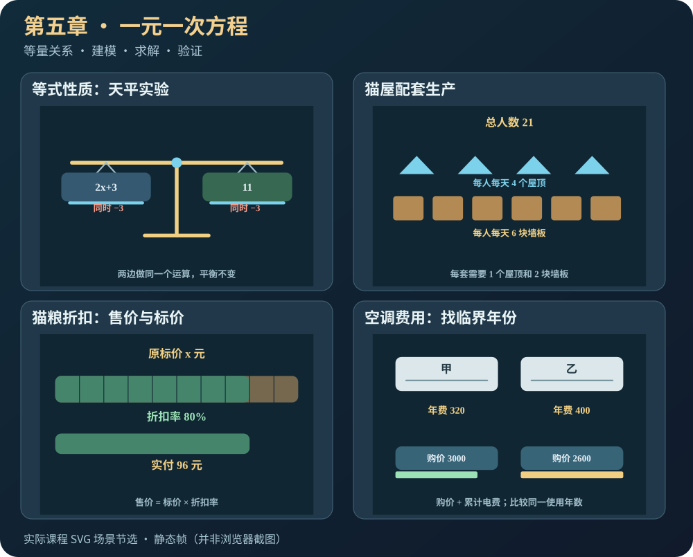 <b>不是看视频，而是进入可操作的数学世界。</b> 动画展示的是现有课程的数学模型静态帧，实际体验请打开课堂。</td>
</tr>
</table>

| 180 个 | 688 道 | 6 个 | 1 套 |
| :---: | :---: | :---: | :---: |
| 新版数学主题 | 练习与独立挑战 | 同步章节及实验模块 | 虚拟教师与互动训练框架 |

另有期中错题专项、小学桥梁及历史课程。上述为现有课程内容统计，不是用户规模或学习成效数据。

## 谁需要这样的数学教室？

| 对象 | 真实需求 | 这个项目提供的价值 |
| --- | --- | --- |
| **孩子** | 不想再听枯燥的重复讲解；希望自己能做出来 | 能说话的老师、可观察的数学过程、可选择的挑战与重试 |
| **家长** | 陪学耗费时间；听懂了却不会独立做题 | 可直接使用的教材同步课堂、独立挑战和针对性回看 |
| **一线教师与学校** | 难以仅靠黑板呈现动态关系；学生掌握程度不同 | 可复用的数学演示与辅助练习，支持非商业课堂实践 |
| **教育研究者** | 如何研究数学认知、心流与知识迁移 | 可观察、可调整的交互教学原型及后续实证研究场景 |
| **教育科技、公益与产业合作伙伴** | 寻找具有真实教育价值、具备持续研发潜力的项目 | 已形成可体验的课程体系，具备进一步验证、扩展与协作的基础 |

孩子与家长是直接使用者，教师是实践与反馈的重要参与者；研究、技术、公益及产业伙伴则可能提供项目进一步发展的支持。

## 它与传统题库或讲题视频有什么不同？

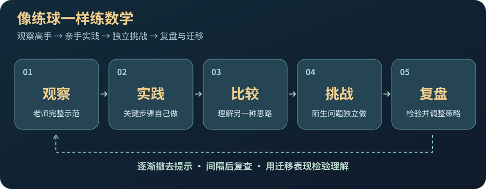

普通题库关注答对多少题，讲题视频主要提供完整解释。本项目尝试把示范、操作、反馈、变式和复盘放在同一训练环境中，让孩子从观看逐步走向独立解决问题。关键不是让孩子在屏幕前待得更久，而是让他能够在离开屏幕后继续思考。

## 为什么做这个项目？

孩子可能记住了公式，却不知道公式从哪里来；能够模仿例题，却在条件稍有变化时无从下手；在家长讲解时频频点头，却不能独立完成一道新题。

这些现象提醒我们：**听懂、会做与真正理解，是三个不同的层次。**

本项目是一套面向初中生的交互式数学思维训练环境，以人教版七年级上册教材为主要依据，将数学概念、运算规则与实际问题转化为可观察的数学模型、动态演示和分步练习。它不是把教材搬到屏幕上，也不是试图用动画和积分包装题库，而是尝试让孩子经历知识的形成过程。

我们借鉴运动训练的逻辑：高手不会只告诉初学者最后得了几分，而会展示如何观察、判断、选择动作、纠正失误，并通过不同情境反复练习。数学学习也应如此。

### 课程可视化一览

以下图组直接节选自现有课程的 SVG 渲染结果，为静态帧而非浏览器实机截图。进入对应课程可体验动画、语音及交互。

#### 第一章 · 有理数

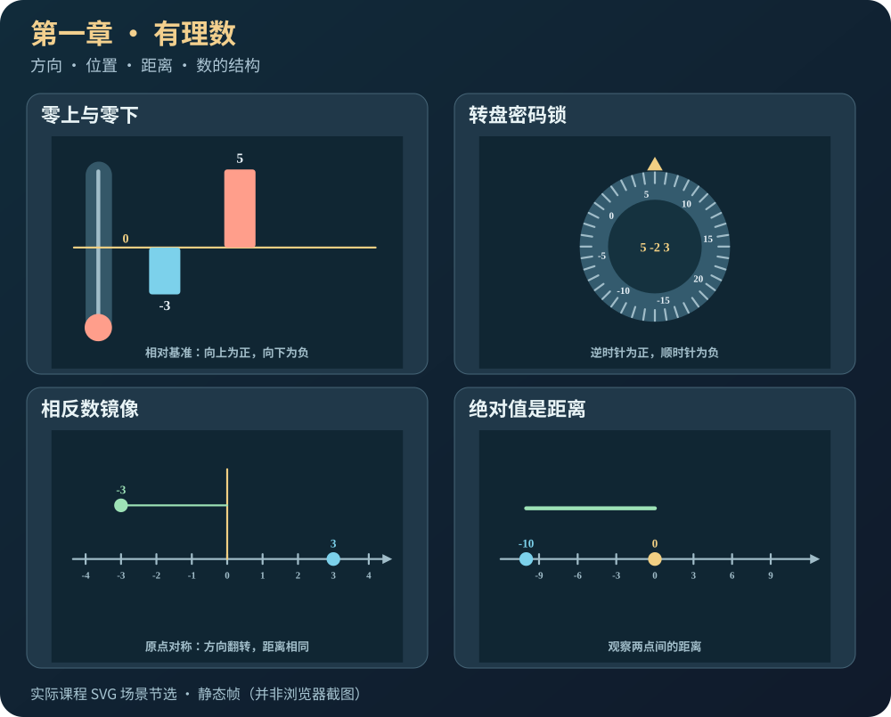

[进入对应课堂](https://zhanglingshare.github.io/grade7-math-visualized/ct1128-chapter1/)

#### 第二章 · 有理数的运算

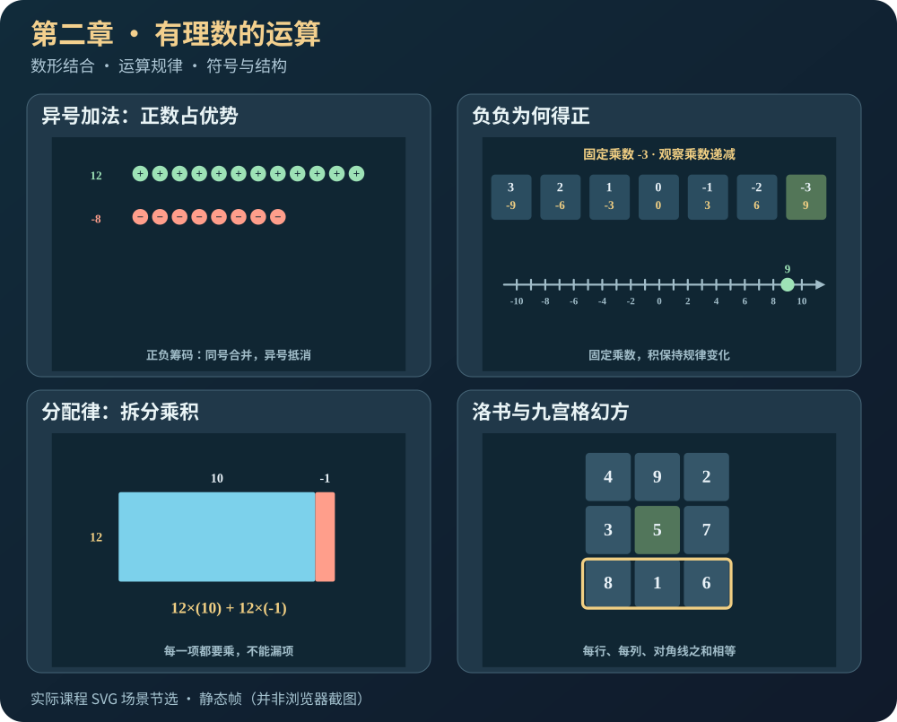

[进入对应课堂](https://zhanglingshare.github.io/grade7-math-visualized/ct1128-chapter2/)

#### 第三章 · 代数式

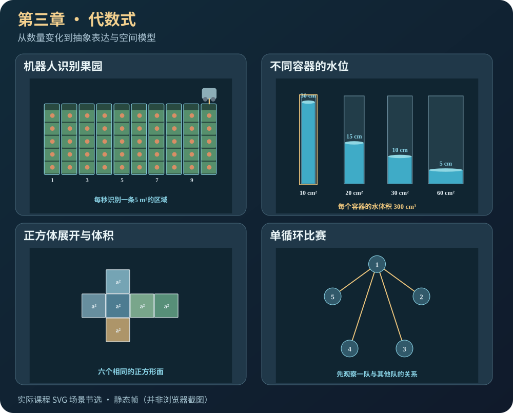

[进入对应课堂](https://zhanglingshare.github.io/grade7-math-visualized/ct1128-chapter3/)

#### 第四章 · 整式的加减

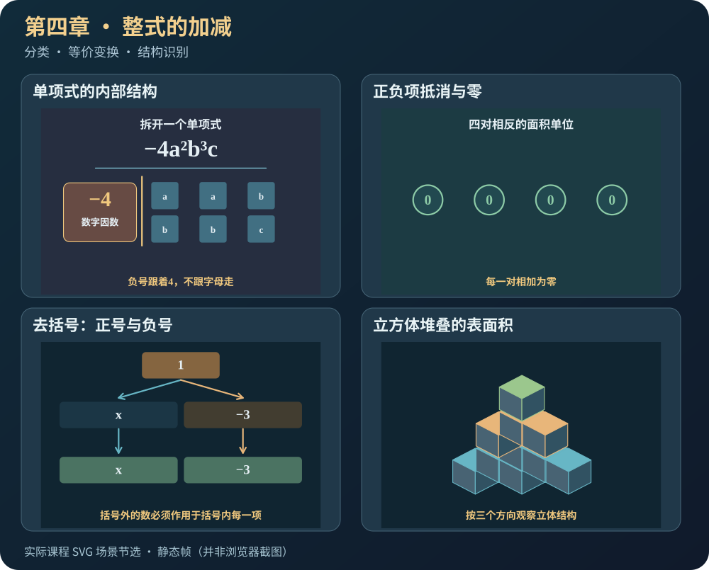

[进入对应课堂](https://zhanglingshare.github.io/grade7-math-visualized/ct1128-chapter4/)

#### 第五章 · 一元一次方程

[进入对应课堂](https://zhanglingshare.github.io/grade7-math-visualized/ct1128-chapter5/)

#### 综合实践 · 数字文明实验室

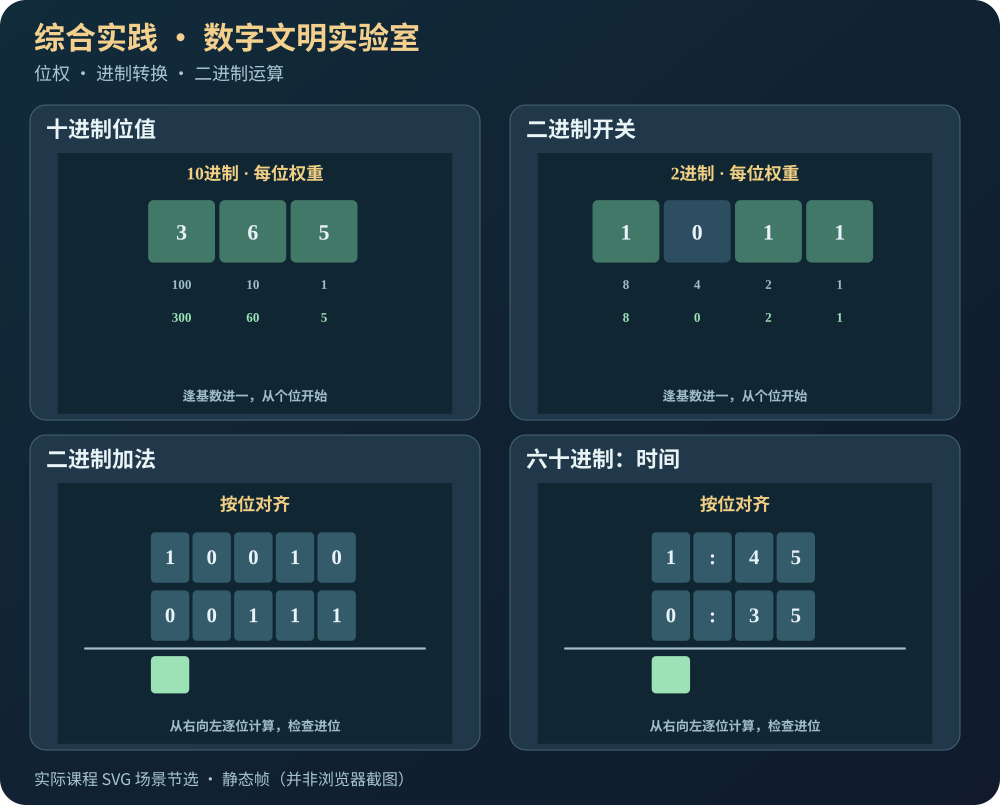

[进入对应课堂](https://zhanglingshare.github.io/grade7-math-visualized/ct1128-number-bases/)

## 核心教育理念：从心流体验到独立思考

**以心流体验激发内在学习动力，以数学可视化建构认知，以持续挑战培养独立思考能力。**

本项目希望借鉴孩子学习运动技能的过程：观察高手、理解动作、亲手尝试、即时反馈、调整策略、迎接更难的挑战。它不是将数学变成娱乐游戏，而是让数学探索本身具有吸引力。

### 1. 心流体验（Flow）：让专注源于问题本身

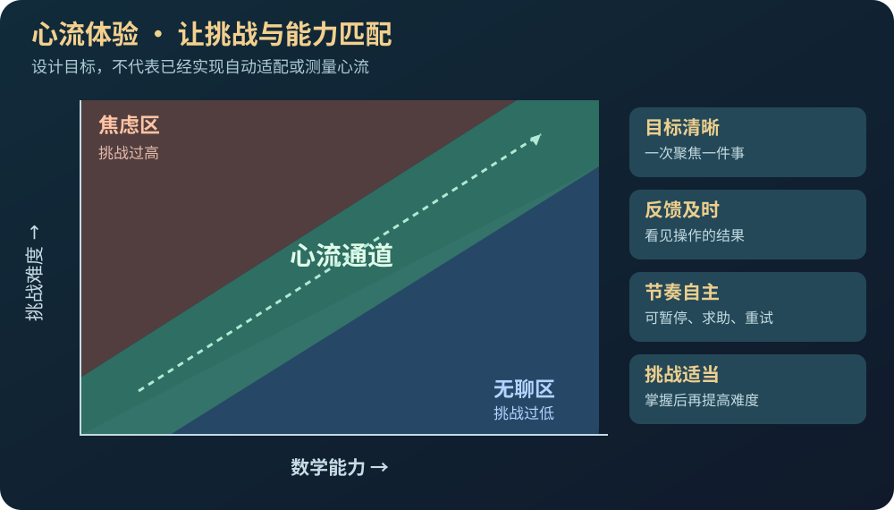

心流理论强调任务挑战与个人能力相匹配、目标清晰、反馈及时等条件。难度过低容易无聊，过高容易产生挫败；课堂应允许孩子选择合适的挑战、控制学习节奏，并在掌握后逐渐提高难度。

具体设计方向：

- 一次聚焦一个明确的数学问题，减少无关按钮、信息和视觉干扰。
- 让老师完整示范，孩子需要思考时主动停下，给足独立操作和判断的时间。
- 通过可视化变化、作答反馈和可重复操作，使孩子看到行动与结果之间的关系。
- 遇到困难时可以回看、寻求帮助，掌握后则减少提示并挑战新问题。
- 不以强制连续签到、无限奖励、排名压力或延长屏幕时间为目标；允许暂停、休息和自主结束。

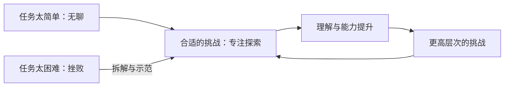

心流是希望创造的学习条件与主观体验，不是一个可以凭观看时间或完成题数自动判定的成绩。现阶段课程提供自主选择、演示、反馈和变式挑战；自动难度适配与个体心流测量并未经过验证。

### 2. 建构认知：让孩子在头脑中形成数学模型

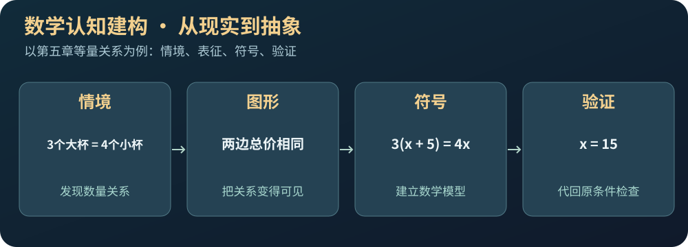

从现实情境进入图形与操作，再进入符号、公式和推理，最终回到现实问题进行检验。数轴不是装饰，而是方向与距离的模型；天平不是道具，而是等式性质的模型；追及动画不是故事，而是速度、时间与位置关系的模型。

目标是逐渐让孩子不依赖屏幕，也能够在头脑中重建数学关系，用自己的语言、图形或算式解释问题。

### 3. 认知学徒式训练：让高手的思考过程可见

老师示范的不只是答案，还包括观察什么、怎样发现结构、为什么选择这种方法、哪些条件容易忽略、如何检验结果。随后逐步撤掉提示，让孩子从观察者变成操作者，再变成独立解题者。

多种思路的价值在于揭示不同结构与策略，不在于展示技巧数量。对于基础尚不牢固的孩子，应先建立一条清晰可靠的解题路线。

### 4. 预测、操作、验证：让知识通过发现形成

对于适合探索的数学内容，鼓励先猜想，再改变条件、观察结果，寻找不变关系，最后归纳规则。例如用乘积规律与分配律解释负负得正，用猜数实验发现缩小搜索区间的策略。

直接讲解与自主探究并不矛盾：新手可以先看完整示范，已有基础后再独立发现与检验。

### 5. 自主性与胜任感：把学习的控制权逐步交给孩子

孩子可以选择看老师、一起做或独立挑战；答错不是处罚，而是定位下一步需要训练的能力。反馈聚焦具体数学行为，不给孩子贴能力标签。希望孩子逐渐从“别人要求我做”转向“我想弄懂这道题”。

### 6. 迁移与反思：用独立表现检验真实学习

能够跟着老师完成一道题，并不代表真正掌握。应当通过陌生变式、不同情境、纸笔作答以及间隔后的再次练习，检查是否可以独立解释、选择策略、求解与验算。

**心流是持续投入的条件，认知建构是学习的过程，独立迁移才是训练的最终目标。** 不能以动画播放量、停留时长或题目数量替代学习效果。

### 理论参考与边界

- Csikszentmihalyi 的心流理论，以及教育情境中的学习心流研究：[Learning flow in educational contexts: A meta-analysis of its antecedents and outcomes](https://pmc.ncbi.nlm.nih.gov/articles/PMC13441015/)。
- [Psychological Flow Training: Feasibility and Preliminary Efficacy of an Educational Intervention on Flow](https://pmc.ncbi.nlm.nih.gov/articles/PMC10204032/)。

以上是项目的设计依据与发展方向，不代表本项目已经获得实证验证；训练有效性仍需以学生真实独立解题、迁移、保持及纸笔表现进行评估。

## 一、训练什么能力？

| 能力 | 具体训练方式 |
| --- | --- |
| 数感与空间思维 | 用数轴、方向、距离、对称、数量变化理解数学符号 |
| 结构识别 | 发现不同题目背后的共同关系，而不是记忆题型名称 |
| 抽象与建模 | 将现实情境转换为数量关系、代数式和方程 |
| 逻辑推理 | 追问规则为什么成立、成立的条件是什么，并尝试用反例检验 |
| 运算与等价变换 | 理解每一次变形的依据，识别符号、括号、运算顺序等错误 |
| 策略选择与迁移 | 比较不同方法，在题目条件发生变化后仍能独立求解 |
| 自主学习与复盘 | 发现自己卡在哪里，选择回看、重练或寻找另一条思路 |

这些是训练目标，不是已经通过教育测量证实的学习效果。

## 二、孩子如何学习？

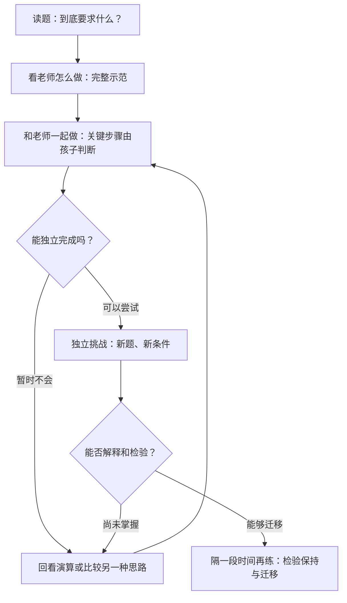

### 1. 看老师怎么做——建立完整的解题样本

林老师通过中文语音、数学动画和分步演算，帮助孩子看清问题、条件、关系与求解过程。孩子可以先观察和理解，不必一进入课堂就被要求回答问题。

### 2. 和老师一起做——逐渐撤掉帮助

将复杂问题拆成关键步骤，让孩子点击、输入、计算或使用草稿板。老师负责讲解和反馈，孩子负责判断与思考。遇到困难时，可以回看演算，而不是一直猜答案。

### 3. 看高手的另一种思路——比较，而不是背更多套路

例如同一道有理数加法题，可以借助数轴理解方向，也可以借助正负筹码理解抵消。同一道方程题，可以比较算术方法与等量关系方法。

只有当另一种方法能够揭示新的数学结构、提供更简洁的推理或帮助检查错误时，才值得引入。并不强求每一道题都存在多种有意义的解法。

### 4. 独立挑战——判断学习是否真的发生

换数字、换条件、换情境，让孩子自己完成计算和判断。正确答案只是证据之一；更重要的是孩子能否解释关键步骤、发现不合理的结果，并在以后面对新题时再次使用所学方法。

### 5. 错误与复盘——让失误成为下一次训练的线索

训练时区分读题错误、概念错误、符号错误、运算错误和策略错误。针对真正卡住的环节回到相应课堂，而不是无差别增加练习量。现有自动反馈能力主要基于答案判定及预设解释，复杂错因仍需孩子自查或家长、教师协助判断。

## 三、为什么使用动画、互动和虚拟老师？

数学动画的价值不在于画面会动，而在于让不可见的关系变得可见。

- **数轴**：将正负数转化为方向与距离，将加减法转化为位置变化。
- **正负筹码**：观察同号合并、异号抵消，理解运算法则。
- **天平与等式**：观察两边实施同一种运算后仍然保持相等，理解方程变形。
- **生产、追及、工程与费用模型**：观察变量变化如何影响结果，理解现实情境中的等量关系。
- **进位制实验**：操作数字位权和二进制开关，体验数字系统的形成逻辑。

虚拟老师承担引导、解释、提问和反馈的角色；人物、语音和动画服务于注意力与数学理解，而不是与题目争夺注意力。孩子可以通过触控或输入参与，不要求一直对设备说话。

## 四、目前的新版课程

**主学习入口：[林老师数学教室](https://zhanglingshare.github.io/grade7-math-visualized/math-home/)**

| 课程 | 训练重点 | 访问 |
| --- | --- | --- |
| 第一章 · 有理数 | 方向、位置、距离、数的分类与比较 | [27个主题 · 81道挑战](https://zhanglingshare.github.io/grade7-math-visualized/ct1128-chapter1/) |
| 第二章 · 有理数的运算 | 运算规则的形成、符号、简算与运算顺序 | [47个主题 · 141道挑战](https://zhanglingshare.github.io/grade7-math-visualized/ct1128-chapter2/) |
| 第三章 · 代数式 | 从具体数量到抽象表达、识别结构 | [40个主题 · 200道练习](https://zhanglingshare.github.io/grade7-math-visualized/ct1128-chapter3/) |
| 第四章 · 整式的加减 | 同类项、去括号与代数结构变换 | [34个主题 · 170道练习](https://zhanglingshare.github.io/grade7-math-visualized/ct1128-chapter4/) |
| 第五章 · 一元一次方程 | 等量关系、等价变形、建模与验算 | [24个主题 · 72道挑战](https://zhanglingshare.github.io/grade7-math-visualized/ct1128-chapter5/) |
| 综合实践 · 进位制 | 数字位权、进制转换、二进制加法 | [8个主题 · 24道挑战](https://zhanglingshare.github.io/grade7-math-visualized/ct1128-number-bases/) |
| 期中错题训练 | 从考试失误回溯概念与解题策略 | [进入训练](https://zhanglingshare.github.io/grade7-math-visualized/ct1127/) |

上述数量是新版课程的内容规模，并非评价孩子水平的指标，也不代表全部教材习题已逐题收录。项目保留旧课程、小学桥梁、单元测试与历史实验，但不将旧版第五章作为新门户的课程入口。

## 五、家长怎样陪练？

建议以每次约20—30分钟的一轮训练为单位，根据孩子的状态灵活调整：先选择一个真正没有掌握的主题，观察一次老师示范，完成若干关键步骤，再独立做一道变式题。最后记录一个发现或一个仍不理解的问题，隔天用新题复查。

不必要求孩子每次都看完整课程。已经掌握的内容可以直接挑战；如果挑战暴露概念缺口，再回到老师的演示。难度应随独立解题表现调整，而不是以完成全部页面为目标。

家长更值得问的是：“你刚才发现了什么？”“哪一步最难？”“如果条件变了，你还会用这个方法吗？” 而不是重复讲解、催促作答或只追问分数。

## 六、如何判断训练有效？

建议观察四类证据，而不是把页面停留时间、动画观看量或刷题数量当成学习成果：

- **理解**：能否用自己的方式解释数学关系。
- **独立**：在没有老师提示时，能否完成一道同结构的新题。
- **迁移**：改变数字、条件或表述后，能否选择合适的方法。
- **保持**：隔天或隔周，能否再次独立解决同类问题。

最终仍应结合纸笔作业、课堂表现和真实考试检验效果。项目不是学校教学的替代品，也不承诺特定分数提升。

## 七、技术、隐私与项目边界

新版课程以 HTML、CSS、JavaScript 和 SVG 实现，使用浏览器中文语音合成及本地学习记录。部分课堂采用共享运行框架，课程内容按章维护。人物表现主要为立绘和视觉动画，而非全部采用真正的三维模型。

语音质量取决于浏览器与设备可用的中文语音；本地进度不会自动跨设备同步。当前部分课堂已通过程序级流程检查，但仍需要真实设备上的视觉、语音、交互验收，以及题目和教学解释的人工复核。尚无独立对照实验能够证明项目的教学效果。

历史版本、资料来源、旧版许可与署名保留于 [历史项目说明](README-history-20261128.md)。历史页面若含第三方素材或数据，仍按各自的许可与署名使用，不能将整个仓库中的第三方内容一概视为原创。

## 下一步共同探索什么

### 从一套数学课堂，到可持续扩展的认知训练环境

当前版本以初一教材同步和真实学习困难为切入点，已经形成可运行的课程原型。它值得进一步探索的，不只是增加几个章节，而是如何把一套训练机制推广到更多数学知识与不同学习者。

项目现有的课程数据、数学场景渲染、语音引导、作答反馈和学习模式，为后续研发提供了基础。未来值得投入的方向包括：

- **教学验证：**联合教师及教育研究者开展小规模试用，研究独立解题、知识迁移、间隔保持等真实成效。
- **个性化训练：**基于可验证的作答证据，探索知识薄弱点识别与挑战难度调节，而非让生成式 AI 无约束出题。
- **内容扩展：**逐步建设更多年级、数学主题及不同表征方式的课程资源。
- **技术与体验升级：**提高虚拟教师表现、语音自然度、动画精度和多设备使用稳定性。
- **教育可及性：**让更多家庭和学校能够以低门槛体验有质量的认知训练。

这些是发展方向，不代表功能已经实现，也不代表已有融资、商业收入、用户增长或经实证验证的教学成效。

## 项目的独立性与发展愿景

林老师数学教室由张凌博士独立发起与开发，是一项基于真实教育需求、个人持续投入的教育探索与技术实践。目前，项目不依托特定科研课题、专项经费或商业投资开展，保持教学理念、技术路线与内容迭代的自主性。

从教材研读、教学设计、原创题目编写，到数学建模、动画演示、语音交互与程序测试，每一次更新都需要持续的时间、精力与技术投入。免费开放，是项目现阶段主动选择的发展方式，并不意味着优质教育资源的研发没有成本。

期待在保持项目教育初心、独立性与非商业公益使用原则的前提下，与认同这一理念的教育工作者、研究者及社会各界开展交流与合作。也欢迎教学实践反馈、专业指导、技术协作及适当的资源支持，共同推动项目持续完善，让更多孩子有机会体验理解数学、发现规律与独立思考的快乐。

欢迎有长期教育价值判断的教育科技机构、科研团队、公益基金及社会资源方关注这一实践。希望优先推动真实课堂试用、教学研究、技术研发和可持续的教育资源建设。任何可能涉及商业合作、资金支持或知识产权授权的安排均需另行协商，并以保持项目独立性、保护未成年人和现有非商业使用原则为前提。

## 八、版权声明

本项目原创内容免费向公众开放，供个人、家庭、学校等进行非商业学习、教学与研究。非商业复制与分享须保留作者署名、版权声明及原项目链接。未经版权所有者事先书面授权，不得用于任何商业目的，包括收费培训、付费课程、商业软件集成、转售及其他营利性用途。

**免费不等于放弃版权，也不等于允许商用。** 第三方内容及历史版本的既有许可继续有效。详细条款见 [版权与非商业使用声明](LICENSE.md)。

---

**我们期待孩子最终获得的不是依赖老师的解题能力，而是逐渐不再依赖老师的思考能力。**
